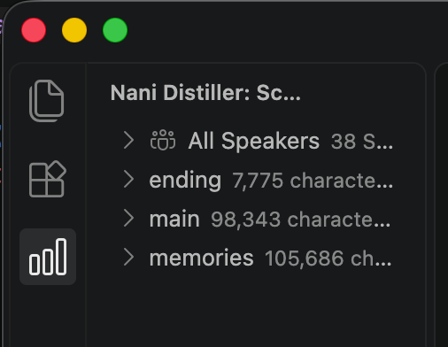

# Naninovel Distiller

[Naninovel](https://naninovel.com/) のシナリオスクリプト（`.nani`）の文字数・ワード数・話者を集計し、VS Code のサイドバーに表示する拡張機能。

## 機能

アクティビティバーの「Nani Distiller」を開くと、「Scenario Statistics」ビューにワークスペース内の統計が表示される。



* **All Speakers**: ワークスペース全体に登場する話者の一覧
* **フォルダ・ファイル**: フォルダ・`.nani` ファイルごとに文字数とワード数を表示する。フォルダの値は配下のファイルの合計
* **ファイルの内訳**: ファイルを展開すると、文字数、ワード数（出現した単語の一覧つき）、そのファイルの話者を表示する

統計はファイルの保存時、アクティブなエディタの切り替え時、設定の変更時に更新される。

### 集計のルール

* コマンド行やコメント行など、本文以外の行は集計しない（判定は [naninovel-script-spec](https://github.com/tunacook/naninovel-script-spec) による）
* `<br>` は取り除き、`<fg>` は中の文字だけを残して数える。`<ruby>` は親文字とルビ文字の両方を数える
* `話者: セリフ` の形式の行は、最初の `:` より前を話者、後ろを本文として扱う。`:` がない行は地の文として行全体を本文にする
* 文字数は本文の前後の空白を除いた文字数。ワード数は本文を空白と句読点・記号で区切った数
* マルチルートワークスペースでは、最初のフォルダだけを集計する

## 必要な環境

* VS Code 1.107.0 以上

## 設定

### `naninovelDistiller.excludeDirectories`

統計スキャンから除外するディレクトリ名のリスト。

デフォルト値:

```json
["docs", "staging-test"]
```

* ディレクトリ名の完全一致で判定する（パスやワイルドカードは使えない）
* 階層の深さに関係なく、同じ名前のディレクトリはすべて除外される
* `node_modules` と `.` で始まるディレクトリ（`.git`、`.vscode` など）は設定に関係なく常に除外される（リストに書く必要はない）
* 値を設定するとデフォルト値は丸ごと置き換わるため、デフォルトの除外も残したい場合は一緒に記載する
* 設定を変更すると統計ビューは自動で更新される

設定例（シナリオのワークスペースの `.vscode/settings.json`）:

```jsonc
{
  "naninovelDistiller.excludeDirectories": [
    "docs", "staging-test",
    "drafts"
  ]
}
```

設定画面（`Cmd+,`、Windows/Linux は `Ctrl+,`）で「Naninovel Distiller」を検索しても変更できる。

なお、カウント対象のファイルは [`.nani` 拡張子（Naninovel シナリオスクリプト）](https://naninovel.com/guide/scenario-scripting)のみで、これは設定では変更できない。配下に `.nani` ファイルが1つもないディレクトリは、統計ビューに表示されない。

## ローカルでの実行方法

### 前提

* Node.js 26（CI と同じバージョン）
* pnpm 10.27.0（10.28 以降は git 依存の `onlyBuiltDependencies` が効かないため固定）
* VS Code 1.107.0 以上

### セットアップ

```sh
pnpm install
```

### デバッグ実行

1. このリポジトリを VS Code で開く
2. `F5` を押す（または「実行とデバッグ」ビューで `Run Extension` を選択して実行）
3. ビルドタスク `full-cleanup-build` が走り、`dist/extension.js` が生成された後、拡張機能が読み込まれた新しいウィンドウ（Extension Development Host）が開く
4. 開いたウィンドウで Naninovel シナリオを含むフォルダを開き、アクティビティバーの「Nani Distiller」から統計を確認する

コードを変更した場合は、Extension Development Host ウィンドウで `Cmd+R`（Windows/Linux は `Ctrl+R`）を押すか、デバッグツールバーの再起動ボタンで再読み込みする。

### その他のコマンド

```sh
pnpm run compile      # ビルド
pnpm run watch        # 変更を監視してビルド
pnpm run check-types  # 型チェック
pnpm run lint         # Lint
```

### VSIX を作成して手元の VS Code にインストールする

```sh
pnpm exec vsce package --no-dependencies
code --install-extension vscode-naninovel-distiller-0.0.1.vsix
```

## Marketplace への公開

VSIX を [Marketplace の管理ページ](https://marketplace.visualstudio.com/manage)から手動でアップロードして公開する。`vsce publish` で使う Azure DevOps のグローバル PAT は 2026年12月1日に廃止されるため使わない。

### 前提

* パブリッシャー `tunacook` に紐づく Microsoft アカウントで管理ページにサインインできること
* パブリッシャー ID（`publisher`）と拡張機能名（`name`）は公開後に変更できない

### 手順

1. `package.json` の `version` を上げ、`CHANGELOG.md` に変更内容を書いて `main` にマージする（同じバージョンは再アップロードできない）
2. `main` を最新にして VSIX を作成する

    ```sh
    git checkout main
    git pull
    pnpm exec vsce package --no-dependencies
    ```

    `vsce` は devDependency なので、`pnpm exec` を付けて実行する。依存パッケージは esbuild で `dist/extension.js` にバンドルされるため、`--no-dependencies` を付けてよい
3. 生成された `vscode-naninovel-distiller-<version>.vsix` を管理ページからアップロードする
    * 初回: 「New extension」→「Visual Studio Code」
    * 2回目以降: 拡張機能の「…」メニュー →「Update」
4. Marketplace 側の検証（数分）が終わると公開される

アイコン・バナー色・キーワードなど Marketplace の表示に関わる項目も、上の手順で新しいバージョンを公開すると反映される。

## リリースノート

[CHANGELOG.md](CHANGELOG.md) を参照。
